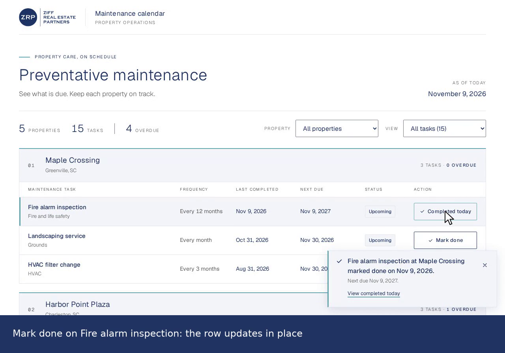

# Preventative Maintenance Calendar

A small browser app for property managers. It lists every recurring maintenance task under its property, shows each next due date, flags overdue work, and lets a user mark a task done. A View select shows all tasks, only due and overdue tasks, or only tasks completed today.

The app reads the two supplied CSV files. It has no server, database, login, or persistent storage. The sample properties, tasks, and dates are fictional.

## Demo

[](docs/demo/maintenance-flow.mp4)

[Watch the 52-second screen recording](docs/demo/maintenance-flow.mp4) (MP4, H.264, no audio). It shows real mouse clicks and key presses on a local production build (`npm run build` and `npm run preview`). The app used the real local date, November 9, 2026. The caption bar below the app frame describes each action. The pointer and click rings were drawn afterwards from the recorded mouse positions, because headless browser capture has no visible pointer.

| Time | Action in the clip |
| --- | --- |
| 0:00 | Overview: 5 properties, 15 tasks, 6 overdue, grouped by property |
| 0:07 | Property filter: a click on "Property" and the Down arrow key select Harbor Point Plaza |
| 0:11 | View: **Due & overdue** shows the two overdue tasks at that property |
| 0:15 | **Mark done** on Fire sprinkler test. The floating confirmation shows done Nov 9, 2026 and next due Nov 9, 2027. The row leaves the due view and the list does not move |
| 0:21 | **View completed today** shows the row with the new dates, status Upcoming, and a **Completed today** button |
| 0:27 | Maple Crossing in the Completed today view gives the empty state |
| 0:31 | **Show all tasks** resets both filters. The overdue count is now 5 |
| 0:34 | **Mark done** on Fire alarm inspection updates the row in place. The overdue count is now 4 |
| 0:39 | **Dismiss confirmation** closes the message. Focus returns to the row without a scroll |
| 0:42 | The footer link opens the offline developer walkthrough and leaves the app page |
| 0:47 | A `path:line` link opens the embedded source at `handleMarkDone` in `src/App.tsx` |

## Quick start

Prerequisite: Node.js `^22.12.0 || ^24.0.0 || >=26.0.0` and npm (the Vitest test runner sets this minimum). Development and checks used Node 24.20.0 and npm 11.19.0.

```bash
git clone https://github.com/adxoxo/gustavo-maintenance-calendar.git
cd gustavo-maintenance-calendar
npm ci
npm run dev
```

Open the local URL that Vite prints, normally:

```text
http://localhost:5173/
```

## Commands

```bash
npm ci              # install the exact versions in package-lock.json
npm run dev         # development server, normally http://localhost:5173/
npm run build       # regenerate the walkthrough, type-check, and build into dist/
npm run preview     # serve the production build from dist/, normally http://localhost:4173/
npm test            # unit, loader, App journey, and walkthrough reference checks
npm run lint        # ESLint
npm run docs        # regenerate public/developer-walkthrough.html only
npm run docs:check  # exit 1 if the walkthrough is out of date
```

## Decisions and reasons

- **React and TypeScript.** This is the brief's preferred stack. Types describe the CSV rows, the derived rows, and the views, so the compiler catches a wrong field or an unhandled view.
- **Vite.** It gives a fast development server, a small production build, and `?raw` imports. The CSV files are bundled as text, so the app needs no fetch and works offline.
- **The CSV files stay the raw input.** `src/data/sample_*.csv` are unchanged copies of the supplied files. Papa Parse reads them, because quoted commas, CRLF line ends, and blank lines are easy to get wrong in a hand-written parser. A validator then checks every field and reference.
- **No backend or database.** The brief allows a page refresh to reset completions. A server would add setup, hosting, and failure modes for no required behavior.
- **Pure calendar-month date math on local dates.** Next due is `last_completed` plus `frequency_months` calendar months, clamped to the last day of a short month. "Today" comes from local year, month, and day fields, never from `toISOString()`, which uses UTC and can give the wrong day in US evening hours.
- **Derived values, not stored values.** State holds only the item array and today's date, plus UI choices. Next due dates, statuses, Completed today flags, groups, view counts, and overdue counts are calculated on each render, so they cannot disagree with the stored completion dates.
- **Functional, immutable updates with stable IDs.** Mark done uses `setItems(prev => completeItem(prev, id, date))`. Only the selected item object changes. React keys use the CSV IDs, so rows keep their identity and focus.
- **Source order.** Rows keep the CSV order in every view. A sort by most overdue would move a row after Mark done and could lose keyboard focus.
- **Few dependencies.** The runtime dependencies are React, React DOM, and Papa Parse. There is no state library, date library, router, or UI kit, because the app does not need them.

## Optional improvements

- **Property filter** (from the brief's nice-to-have list): one select with an **All properties** default. Portfolio totals stay portfolio-wide.
- **View filter:** **All tasks** (default), **Due & overdue**, and **Completed today**. Each option shows its count for the selected property.
- **Portfolio and property counts:** a manager sees where late work is without a scan of every row. A section in a filtered view shows its visible task and overdue counts.
- **Empty state:** when no task matches, a message explains why and **Show all tasks** resets both filters.
- **Fixed confirmation:** a message fixed to the bottom right of the viewport names the task, its property, the completion date, and the next due date. It never moves the task list and never takes focus. It sits in an always-present `role="status"` live region. It has no auto-dismiss timer.
- **Focus and scroll:** **View completed today** focuses the View select. **Dismiss confirmation** returns focus to the row's button (or the View select if the row is not shown) without a scroll. A completion in **Due & overdue** removes the row, so focus moves to the View select. The **Completed today** button uses `aria-disabled="true"`, not `disabled`, so keyboard focus stays on it.

**Completed today** means `last_completed` equals today's local date. It is not a permanent "done" state. A recurring task keeps its new next due date and its status (normally Upcoming), and it comes back as a normal task on the next day.

## Limits

- **Memory only.** Completions live in browser memory. A reload or a new app instance (for example, a new tab) restores the CSV values.
- **No midnight timer.** The app reads today again when the window gets focus, when a hidden tab becomes visible, and on each Mark done click. A page left open and focused across midnight updates on the next focus, tab return, or click. The Mark done handler compares with the freshly read date, so the first click after midnight saves the new day.
- **Fonts.** The CSS names the brand's Adobe Fonts first. Those font files are not bundled or downloaded. The bundled Geist and Geist Mono files (SIL Open Font License, `src/assets/fonts/GEIST-OFL.txt`) are the offline fallback.
- **Scope.** No login, backend, deployment, CSV upload, editing, reminders, category filter, or calendar grid. The app is a local take-home build, not a production service.
- No manual screen-reader test was run.

## How it works

```text
src/data/*.csv  ──?raw import──▶  loadMaintenance()  ──ok──▶  App state: items + today
                                       │                          │
                                       └──errors──▶ DataError     ▼
                                                    buildPropertyGroups(properties, items, today)
                                                      └─ toMaintenanceRow → addMonthsClamped + getStatus + completed_today
                                                          ▼
                                       property filter → countViews (View counts) → filterGroupsByView
                                                          ▼
                                                    PropertySection → MaintenanceRow → Mark done
                                                          │
handleMarkDone(item_id) ─ todayLocal() once ─ guard: done on that date? stop
                        └─ setItems(prev => completeItem(prev, id, date)) + floating confirmation
```

| Path | Purpose |
| --- | --- |
| `src/data/sample_*.csv` | Unchanged copies of the supplied data |
| `src/data/source.ts` | Imports both CSV files as text and calls the loader once per page load |
| `src/data/loadMaintenance.ts` | Papa Parse plus field, date, frequency, duplicate-ID, and property-reference validation |
| `src/domain/types.ts` | `Property`, `MaintenanceItem`, derived `MaintenanceRow` (with `completed_today`), `PropertyGroup`, `TaskView`, `ViewCounts`, `LoadResult` |
| `src/domain/dates.ts` | `todayLocal`, `addMonthsClamped`, `getStatus`, date validation and display |
| `src/domain/maintenance.ts` | `completeItem`, `toMaintenanceRow`, `buildPropertyGroups`, `matchesView`, `countViews`, `filterGroupsByView` |
| `src/App.tsx` | Page state, today refresh, `handleMarkDone`, property and View filters, counts, empty state, floating confirmation and its handlers |
| `src/components/*.tsx` | Property section, task row, and data error panel |
| `scripts/` | Walkthrough generator and its reference checks |
| `public/developer-walkthrough.html` | Generated offline developer guide |
| `docs/demo/` | Demo recording and poster |

- **Data read.** The loader parses both CSV strings with Papa Parse. IDs stay strings. `frequency_months` becomes a positive safe integer.
- **Invalid data.** Any missing column, empty field, impossible date, bad frequency, duplicate ID, or unknown `property_id` shows an error panel with every problem. The page never shows a partial task list.
- **State.** Domain state is the item array and today's date. UI state is the property filter, the view (`all`, `due`, or `completed-today`), the highlighted row (`lastCompletedId`), and the task in the confirmation (`confirmationId`). A ref (`focusCheckId`) records a completion for one focus check after render. Properties are fixed.
- **Mark done.** The handler reads the clock once and stores that date as today. If the item was already completed on that date, it stops: this covers the Completed today button and a same-day repeat. Otherwise it calls a functional updater, and `completeItem` copies only the selected item with the new `last_completed`.
- **Views.** The property filter runs first. `countViews` counts its rows for the View options, so the counts follow the selected property. `filterGroupsByView` then keeps matching rows in source order, recounts each section's overdue rows, and removes empty sections. The portfolio summary always counts the whole portfolio.

## Date rules and examples

- Overdue means the next due date is before today. A task due today shows **Due today** and is not overdue.
- Mark done sets `last_completed` to today, so the next cycle starts from the completion date, not from the old due date. A second click on the same day changes nothing.
- **Due & overdue** shows tasks with `next_due` on or before today, so it includes due-today tasks.
- Dates are compared as zero-padded `YYYY-MM-DD` strings. All supplied properties are in US time zones, so the user's local date is the working assumption.

| Last completed | Frequency | Next due | Reason |
| --- | --- | --- | --- |
| 2026-01-31 | 1 month | 2026-02-28 | February 2026 has 28 days |
| 2024-01-31 | 1 month | 2024-02-29 | Leap year |
| 2026-08-31 | 3 months | 2026-11-30 | November has 30 days (item 3) |
| 2025-11-03 | 12 months | 2026-11-03 | Overdue on 2026-11-09 (item 1) |
| 2026-11-09 | 12 months | 2027-11-09 | Item 1 after Mark done on 2026-11-09 |

On November 9, 2026, the supplied data shows five properties, fifteen tasks, and six overdue tasks: items 1, 5, 6, 9, 13, and 14. The overdue count depends on the date you run the app.

## Developer walkthrough

`public/developer-walkthrough.html` is a single offline HTML file. It traces the CSV read path and the Mark done path in six steps each, including the View filter, the Completed today button, and the floating confirmation. It also lists fields, page UI state, functions, components, and date, view, and focus rules.

To open it:

- With `npm run dev` or `npm run preview`, use the **Developer walkthrough** link in the app footer, or open `/developer-walkthrough.html` on the same local URL.
- Without a server, download the file (or use your clone) and open it directly in a browser. It needs no server, CDN, or editor.
- The GitHub file view shows the HTML source only. It does not run the page.

Every `path:line` link comes from the actual source. `scripts/generate-walkthrough.mjs` finds each function, field, call site, state write, and JSX element in the TypeScript syntax tree, and it fails if a target is missing or ambiguous. The links open an embedded copy of the referenced source files with the target line highlighted.

`npm run build` regenerates the file first. After a source edit, run `npm run docs` to regenerate the exact file-and-line guide, or `npm run docs:check` to confirm it is current. The step data snapshots are explanatory examples fixed to November 8, 2026; the code excerpts are current source lines.

## Tests

- `src/domain/dates.test.ts`: month-end clamps (including items 2, 3, 11, and 15), leap year, year change, due-today boundary, local midnight, date validation.
- `src/domain/maintenance.test.ts`: grouping and overdue IDs with the real CSVs, single-item completion without mutation, same-day repeat, unknown ID, `completed_today`, the due-today view boundary, view counts, and view filtering that recounts overdue rows and removes empty groups.
- `src/data/loadMaintenance.test.ts`: supplied files (including the CRLF properties file), quoted commas, blank lines, and each rejection rule.
- `src/App.test.tsx`: the user journey with a frozen local date (`vi.useFakeTimers({ toFake: ['Date'] })`): counts, Mark done, the Completed today button state, unchanged neighbors, same-day repeat, refresh reset, keyboard completion with kept focus, property and View filters, focus when a row leaves Due & overdue, View completed today, Dismiss with kept scroll and row focus, the empty state and reset, focus refresh of today, the first click after midnight, a source row completed today, and the error panel.
- `scripts/walkthrough.test.mjs`: every documented reference lands on the intended line, and the generated file is portable and offline.

## Visual design

- The layout follows the approved mockup: property sections, a wide task grid on desktop, and stacked labeled rows on narrow screens.
- The visual brand follows https://www.ziffcre.com/: navy `#223562` for text and actions, teal `#65A6AF` for borders and highlights only, surface `#F5F6F9`, border `#E3E6EC`, secondary text `#5E5E5E`, square controls, and tracked uppercase labels.
- `src/assets/ziff-logo.png` is the unchanged official logo.
- Controls are at least 44px tall, focus is visible, and status uses text with color.
